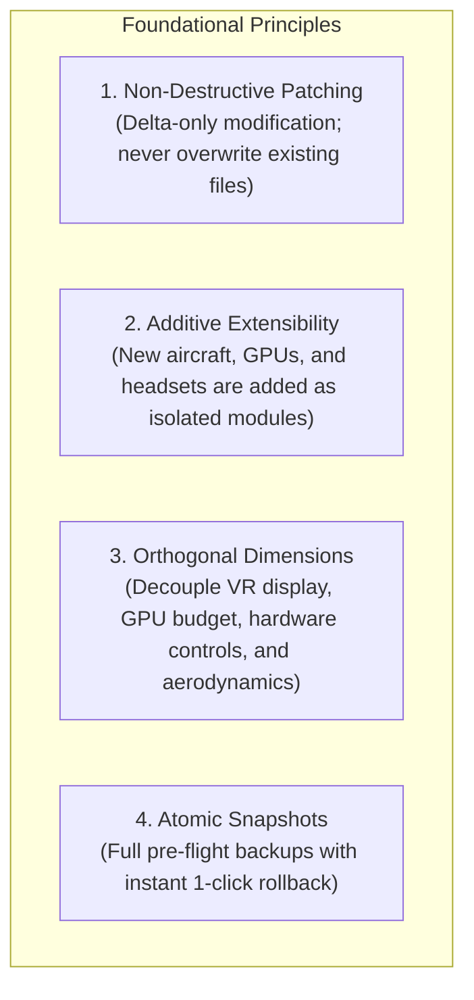
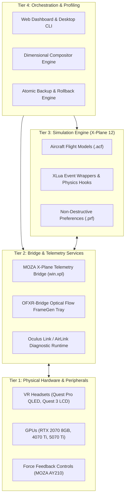

# FlightSim Architecture & Design Blueprint

A modular, additive architecture for high-fidelity flight simulation, VR optimization, force feedback control, and realistic flight dynamics.

---

## 1. Architectural Philosophy

Standard flight simulation configurations often suffer from tight coupling and configuration decay:
* Installing a new aircraft or control profile frequently overwrites global joystick settings.
* VR optimization tools often force whole-file replacements, wiping out multi-monitor window layouts and input calibrations.
* Force feedback parameters are either hardcoded or uncoupled from physical aircraft flight characteristics.

This repository is built around four fundamental architectural pillars:

---

## 2. Multi-Tier System Hierarchy

The architecture spans four decoupled operational tiers:

---

## 3. The Four Decoupled Dimensions

Instead of monolithic profiles that combine every setting into a rigid block, the configuration system divides parameters into four independent, orthogonal dimensions:

| Dimension | Directory | Key Responsibilities |
| :--- | :--- | :--- |
| **VR Headset** | `configurator/profiles/vr_headsets/` | Panel resolution, refresh rate, eye tracking, Mini-LED local dimming, optical FOV crop, link encode width, and pixel density ($1.15\times$ to $1.25\times$). |
| **GPU & VRAM** | `configurator/profiles/gpus/` | VRAM ceiling protection ($8\,\text{GB}$, $12\,\text{GB}$, $16\,\text{GB}$), texture resolution scaling, 3D object density, and Optical Flow Frame Generation modes. |
| **Hardware & CPU** | `configurator/profiles/hardware/` | CPU thread affinity, flightmodel simulation substeps (`_fms_per_frame`), peripheral VID/PID bindings, and telemetry polling. |
| **Aircraft Module** | `configurator/profiles/aircraft/` | POH ground runup speeds, single-magneto drop tolerances, Catmull-Rom response splines, combined switch routing, and cockpit mesh options. |

### Dynamic Composition Rule
When a user launches or applies a profile:
$$\text{Runtime Configuration} = \text{Base Baseline} \oplus \Delta_{\text{Headset}} \oplus \Delta_{\text{GPU}} \oplus \Delta_{\text{Hardware}} \oplus \Delta_{\text{Aircraft}}$$
Where $\oplus$ denotes a non-destructive associative merge that only updates specified keys without mutating any other configuration state.

---

## 4. Aircraft Customization Architecture (`xplane/`)

### Isolated Script Enclaves
All aircraft enhancements reside in isolated XLua scripts inside each aircraft's plugin hierarchy:
* **Cessna 172 SP:** `plugins/xlua/scripts/c172_starter/` and `c172_electrical/`
* **Just Flight C152:** `plugins/xlua/scripts/c152_moza/`

### Command Wrapping vs. Command Overwriting
Rather than altering core X-Plane command tables, scripts use XLua's native `wrap_command(command_name, before_handler, after_handler)`:
1. **Direct Rotary Switch Interception:** Overrides X-Plane's two-position toggle limitation (`cmp [state], 3`) so continuous 5-position rotary switches immediately select `OFF`, `R`, `L`, `BOTH`, or `START`.
2. **Synchronized Master Switches:** Intercepts `battery_1_on` / `battery_1_off` to switch both Battery and Alternator buses in unison.
3. **Calibrated Magneto Drop:** Hooks into `before_physics()` to calculate real-world Lycoming power reductions dynamically based on engine RPM, automatically returning to full baseline power when returned to `BOTH`.

---

## 5. MOZA Force Feedback & Telemetry Architecture (`moza/`)

Force Feedback operates via real-time UDP/IPC telemetry streaming between X-Plane and MOZA Cockpit:

1. **Telemetry Injection:** `moza/telemetry_plugin/win.xpl` captures aircraft angular velocities, dynamic pressure ($q = \frac{1}{2}\rho v^2$), engine RPM, G-load, and surface deflections.
2. **Automated Aircraft Matching (`OptimalMatch.vconfig`):** When X-Plane loads a specific `.acf` file, MOZA Cockpit automatically indexes `OptimalMatch.vconfig` and hot-swaps the corresponding `.preset`.
3. **Aerodynamic Stiffening & Haptic Curves:** Each preset configures:
   * **Aerodynamic Stiffening:** Quadratic resistance buildup between rotation speed ($V_R$) and maximum structural cruise ($V_{NO}$).
   * **Propwash Elevator Lift:** Yoke rests forward on ground (elevator droop) and lifts into neutral as propwash and airspeed develop.
   * **Harmonic Engine Rumble:** Engine firing pulses mapped to real-world engine RPM (e.g., Lycoming IO-360 vs. O-235).

---

## 6. Safety, Backup, & Disaster Recovery

Every action taken by the Configurator or installation scripts executes atomic pre-flight checks:
* **Pre-flight Snapshots:** Copies `X-Plane.prf`, `X-Plane Window Positions.prf`, and the Windows Registry Oculus tree to a timestamped folder under `backups/`.
* **State Journaling:** Records `last_applied_profile.json` with the exact parameter set and timestamp.
* **1-Click Rollback:** Can be invoked through the Web UI, CLI (`--restore <id>`), or manual file copy.
