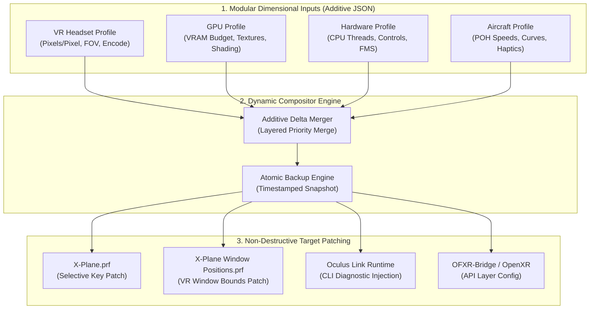
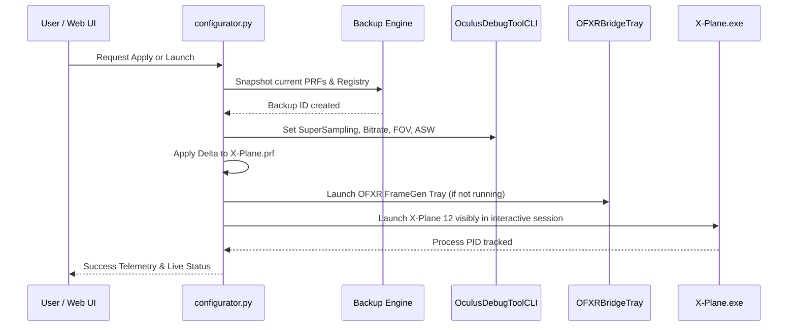

# Configurator Architecture & Design Principles

This document explains the internal architecture, design philosophy, and extension mechanisms of the **X-Plane 12 VR Configurator**.

---

## 1. Core Architectural Principle: Non-Destructive Additive Composition

A standard problem in flight simulator utility software is "profile clobbering"—tools that overwrite entire `.prf` files, destroying monitor alignments, calibrated joystick curves, sound settings, and custom key bindings.

The Configurator is built on a strict **Non-Destructive Additive Composition** principle:

> **Rule:** Never overwrite entire configuration files. Always parse existing settings in memory, merge only targeted dimensional deltas, preserve all unrecognized keys and comments, and snapshot full atomic backups before committing to disk.



---

## 2. Dimensional Decomposition

Instead of maintaining a combinatorial explosion of monolithic profiles (e.g., `quest_pro_rtx2070_c172`, `quest_3_rtx4070_c152`), the system factorizes configurations into four orthogonal dimensions:

### A. VR Headset Dimension (`profiles/vr_headsets/*.json`)
Encapsulates physical display hardware and optical delivery:
* **Panel Technology:** Refresh rates (72Hz, 80Hz, 90Hz), subpixel matrix, and Local Dimming flags.
* **Optical Sweetspot:** FOV Tangent Multipliers (e.g., Quest Pro pancake lenses utilize `[0.80, 0.74]` horizontal/vertical crop to boost center pixel density).
* **SuperSampling & Link Encoding:** `pixels_per_display_pixel` (e.g., 1.25x for instrument text clarity) and `encode_resolution_width` (3600px vs 4000px).
* **Reprojection:** Depth reprojection and Meta ASW mode toggles.

### B. GPU Dimension (`profiles/gpus/*.json`)
Encapsulates compute, VRAM budgets, and frame generation modes:
* **VRAM Ceiling Protections:** Setting `vr_renopt_tex_res_04` and `renopt_tex_res_04` to prevent VRAM overflow paging on 8GB/12GB/16GB cards.
* **Optical Flow Strategy:** Configuring OFXR-Bridge modes (`fast_low_vram` for 8GB GPUs vs `normal`/`high_quality` for 12GB+ GPUs).
* **Shading & Object Density:** Balancing `vr_renopt_draw_3d_04`, `vr_renopt_clouds_02`, and shadows.

### C. Hardware & CPU Dimension (`profiles/hardware/*.json`)
Encapsulates system topology and peripheral inputs:
* **Frame Simulation Steps:** `_fms_per_frame` (multi-threaded flightmodel substeps for high-core CPUs like the i9-9900K).
* **Control Telemetry:** Telemetry bridge activation and USB FFB polling rates for the MOZA AY210.

### D. Aircraft Dimension (`profiles/aircraft/*.json`)
Encapsulates aircraft-specific physics, runup thresholds, and cockpit interactions:
* **POH Runup RPM & Drop Range:** Calibration bounds for single-magneto drop checks.
* **Switch Wrappers:** Combined Master ALT/BAT, Avionics/Pitot routing, and rotary magneto behavior.
* **Model Hooks:** Pilot avatar mesh suppression for cockpit visibility in VR.

---

## 3. Non-Destructive Delta Patching Algorithm

The preference updater (`update_xp_prf_files()`) implements an in-place delta algorithm:

1. **Read & Parse:** The target file (`X-Plane.prf`) is loaded line by line.
2. **Key Matching:** Each line is split on whitespace into `key` and `value`.
3. **Selective Replacement:**
   * If `key` exists in the composed delta dictionary, the line is updated with the new formatted value.
   * If `key` is not in the delta, the line is preserved byte-for-byte (including comments, formatting, and unknown third-party plugin keys).
4. **Additive Append:** Any new keys specified in the delta that did not previously exist in the file are appended to the end.
5. **Window Positioning:** `X-Plane Window Positions.prf` is inspected to configure the primary VR desktop companion window without altering multi-monitor layout coordinates.

---

## 4. Subsystem Integration & Execution Flow



---

## 5. How to Add New Profiles (Extensibility Guide)

Adding new hardware or aircraft requires **zero changes to core code**:

### Adding a New GPU (e.g., RTX 5080 16GB)
Create `configurator/profiles/gpus/rtx_5080_16gb.json`:
```json
{
  "id": "rtx_5080_16gb",
  "name": "NVIDIA GeForce RTX 5080 (16GB VRAM)",
  "category": "gpu",
  "vram_gb": 16,
  "optical_flow_supported": true,
  "optical_flow_preset": "high_quality",
  "xp_gpu_settings": {
    "vr_renopt_tex_res_04": 4,
    "vr_renopt_draw_3d_04": 3,
    "vr_renopt_clouds_02": 3
  }
}
```

### Adding a New VR Headset (e.g., Bigscreen Beyond)
Create `configurator/profiles/vr_headsets/bigscreen_beyond.json`:
```json
{
  "id": "bigscreen_beyond",
  "name": "Bigscreen Beyond (OLED 2560x2560)",
  "category": "vr_headset",
  "display": {
    "panel": "Dual Micro-OLED",
    "refresh_rate_hz": 75
  },
  "odt_settings": {},
  "ofxr_bridge": {
    "enabled": true,
    "target_fps": 75
  },
  "xp_vr_overrides": {
    "_rcas_ratio": 0.65,
    "vr_renopt_ANISO": 16
  }
}
```

### Adding a New Aircraft (e.g., Beechcraft Baron 58)
Create `configurator/profiles/aircraft/beech_baron_58.json`:
```json
{
  "id": "beech_baron_58",
  "name": "Beechcraft Baron 58 (Twin Engine)",
  "category": "aircraft",
  "poh_runup_rpm": 2200,
  "xplane_profile": "B58 - MOZA AY210"
}
```

The Compositor automatically discovers all `.json` files in `profiles/` at startup and exposes them to the Web UI and CLI.
